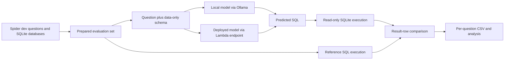

# Architecture and Evaluation

## Purpose

This repository compares complete text-to-SQL **pipelines** on the same questions. A model is one component; schema and semantic context, retrieval, planning, query generation, validation, and execution can all affect the final result. Spider provides the benchmark questions, reference SQL, schemas, and databases. Our goal is to improve the local Qwen-based system and compare it with the deployed Lambda system.

## Data and Schema Preparation

For sharing, the downloaded Spider archive and extracted source databases stay outside Git and are downloaded after cloning. Fixed evaluation questions, semantic assets, reviewed notes, and small study results remain versioned. See [README.md](README.md) and [data/README.md](data/README.md) for setup and the pending downloader, dependency file, ignore rules, and path portability work. The current files are not yet portable to another checkout location.

We downloaded the Spider dataset and SQLite databases into `data/`. `scripts/prepare_dataset.py` builds `data/eval_sample.json` from the Spider development split. It retains **1,032 executable questions across all 20 development databases**; two source questions were excluded because their reference SQL did not execute. Each record contains a question, database ID and path, reference SQL, schema text, and a local complexity bucket. The bucket is a project heuristic, not Spider's official hardness label.

For those 20 databases, `scripts/build_semantic_schema.py` generates schema descriptions with database-derived context. The evaluation-safe version in `data/semantic_layer_dataonly/` adds observed low-cardinality values, numeric ranges, row counts, and detected key quirks to the schema. The current Spider dev evaluations use this version. The richer `data/semantic_layer/` includes patterns mined from Spider dev answers and is **not used to evaluate those same dev questions**. `data/semantics_json/` holds machine-derived schema facts; `data/semantic_catalog/` adds a bounded value index. The manually authored `data/reviewed_semantics.md` records structural interpretations and corrections for all 20 databases. The separate grounded runner now adds these catalog candidates and notes to Qwen's direct-SQL prompt; the structural review is not a final business glossary.

## Benchmark Harness



`scripts/run_eval.py` sends each question and its annotated schema to a local Ollama model. It executes the generated SQL and reference SQL against the same SQLite database in read-only mode. A prediction is correct when the two result sets match as order-insensitive multisets of rows; SQL text need not match. Responses, errors, latency, and correctness are saved one question at a time under `results/runs/spider_baseline/`. Runs resume by question ID, so a long CPU-only evaluation can continue after interruption. `scripts/aggregate.py` summarizes per-model and per-complexity results. The diagram shows the common grading path; each competing system can have additional stages before returning SQL.

## System Configurations and Results

The study compares complete configurations on the **same 1,032-question target set**. The completed local runs use the data-only semantic schema and direct SQL generation. Their scores therefore measure the model **within that pipeline**.

| System configuration | Evaluation status | Correct / 1,032 | Execution accuracy |
|---|---|---:|---:|
| Qwen 2.5 Coder 14B + current local pipeline | Complete | 808 | 78.3% |
| Llama 3.1 8B + current local pipeline | Complete | 733 | 71.0% |
| DeepSeek Coder V2 16B + current local pipeline | Complete | 711 | 68.9% |
| Deployed Lambda pipeline with multilevel semantics | Planned | — | — |

## Optimizing the Local System

Qwen 14B is the strongest completed local foundation, so the next work is to improve the **pipeline around it**. `scripts/run_grounded_eval.py` adds the reviewed structural notes and question-specific schema, join, and value candidates to the full data-only schema, then asks for SQL directly in one Ollama call. It writes a separate resumable result set and paired baseline comparison. Accuracy is unmeasured until the grounded run executes. Reviewed business definitions, explicit logic planning, and bounded read-only verification remain proposals until implemented and measured.

Each configuration should have its own saved results and be compared question by question against the frozen Qwen baseline. Report net recovered and regressed IDs, overall and complexity-level accuracy, latency, and model or SQL calls. The competition is decided by **end-to-end correctness under the same grader**, with latency and resource cost recorded alongside it. Do not use Spider dev reference SQL to build semantic rules or prompts for a system evaluated on that split.

## Separate Per-Database LoRA Pilot

`lora_study/college_2/` is an isolated training-database experiment. The initially proposed `geo` database has empty SQLite tables in this download, so `college_2` was selected as the largest populated training database (170 pairs). Its fixed SQL-pattern-grouped split is 118 train, 26 validation, and 26 test. Both untuned Qwen and a future `college_2` adapter use the same data-only schema, manually reviewed structural notes, question-grounding algorithm, direct-SQL prompt, and held-out grader. Training files include only train and validation answers. See its README for commands and the limits of this small pilot. This work does not alter the running 20-database dev evaluation.

## Next Evaluation: Deployed Model

The Lambda evaluation code is already implemented in `scripts/run_cloud_eval.py`; the **benchmark run and score are planned**. The runner will send the same 1,032 Spider dev questions, each with its schema and data-only semantic schema, to the deployed system's HTTP endpoint. The deployed system can apply its own multilevel semantics before returning SQL. The runner will grade that SQL locally against the same SQLite databases and execution-accuracy metric used for the local systems. Reference SQL and expected answers stay local. Results will be saved separately under `results/cloud/<run>/`, with one CSV and summary per configuration, so the deployed pipeline can be compared with local Qwen without changing either result set.

The endpoint URL, authentication, model ID, and response format need to match the deployed service before the run starts. See `cloud/README.md` for the request contract and dry-run command. The table above will receive a score only after all 1,032 IDs have been evaluated.

## Reproducing the Tests

Run one Ollama evaluator at a time on this CPU machine:

```bash
python3 scripts/run_eval.py qwen2.5-coder:14b qwen25coder_14b 250 --dataset=dev --lever=spider_baseline
python3 scripts/build_semantic_catalog.py  # rebuild source-grounded catalogs
python3 scripts/ground_question.py --id 153  # preview context; no model call
python3 scripts/run_grounded_eval.py --dry-run  # preview direct-SQL prompt
python3 scripts/run_grounded_eval.py --max-new 10  # resumable grounded pilot
python3 scripts/run_grounded_eval.py  # complete the grounded comparison
python3 -m unittest discover -s tests -p 'test_semantic_grounding.py'
```

The first command resumes the existing baseline; it does not reset it. Do not rebuild `data/eval_sample.json` unless changing the benchmark itself. Keep dev reference SQL out of model prompts and training examples. For run status, read the CSVs with Python's `csv` module because responses can contain embedded newlines; `wc -l` is not a reliable question count.
